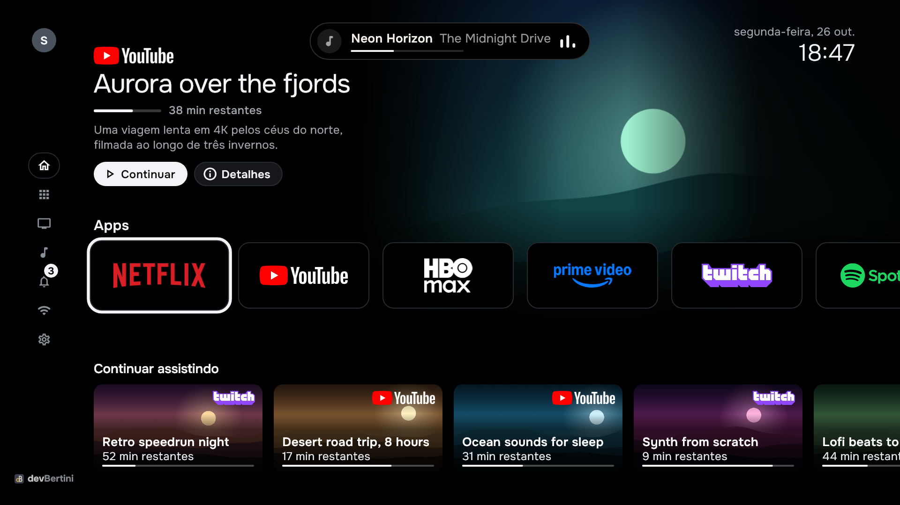
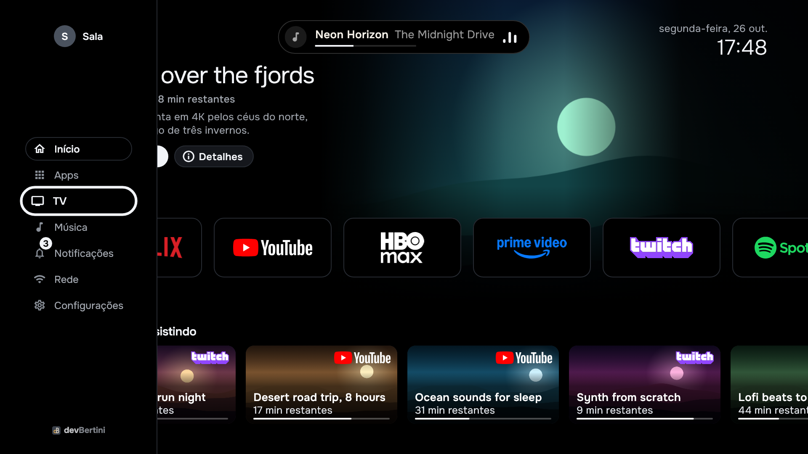
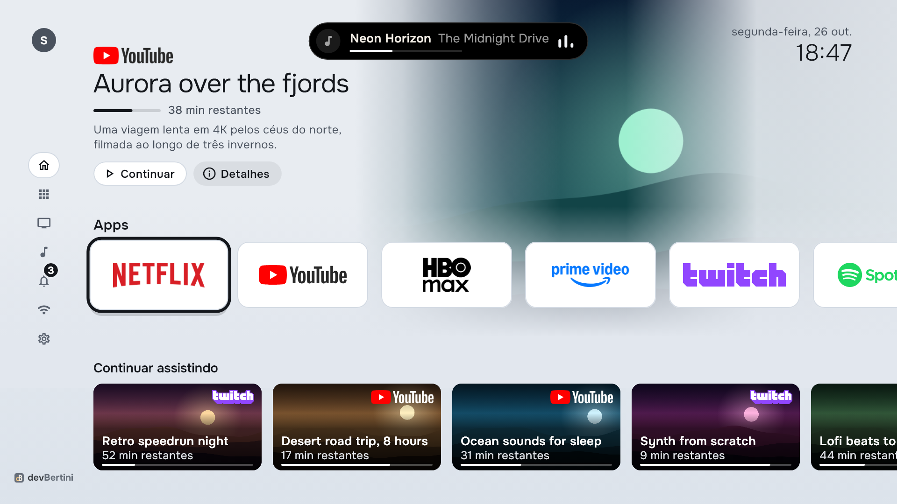

# devBertini TV Launcher

By **Claudio Bertini** (devBertini): [GitHub](https://github.com/devBertini),
[LinkedIn](https://www.linkedin.com/in/claudio-bertini/).

A home screen for Android TV and Google TV, made to feel like a premium streaming box: your newest show up front,
your apps as clean brand plates, and a quiet side rail for everything else. Built in Flutter, measured frame by
frame on a real mid-range TV, private by design.

It is a fork of [LTvLauncher](https://github.com/leanbitlab-org/LtvLauncher), which comes from
[osrosal's FLauncher](https://github.com/osrosal/flauncher) and the original
[FLauncher](https://gitlab.com/flauncher/flauncher), with a new home called **Vitrine**, TV extras and a set of tools to
measure and install it. Licensed under the GPL-3.0 or later, like the projects it comes from.

> **Em português.** Uma tela inicial para Android TV e Google TV, feita em Flutter: o último programa que você estava
> vendo em destaque, os apps como placas com o logo de cada marca e um menu lateral discreto. Tema escuro e claro,
> perfis, ilha de música, relógio com clima, protetor de tela em preto puro e modo noite. Foi medida quadro a quadro
> numa TV real (TCL C7K) até ficar a 60 quadros por segundo ao andar pela fileira de apps. Feito por Claudio Bertini
> (devBertini), é um fork do LTvLauncher sob a licença GPL-3.0. A documentação está em inglês; a tela inicial fala
> português e inglês, e os painéis de ajustes, português.



| Side rail open | Light theme |
|---|---|
|  |  |

*The pictures are the real widgets rendered by `test/devbertini/vitrine_capture_test.dart`; the landscapes and the
titles are made up for them.*

## Features

**The Vitrine home**
- A hero with the program you watched last, from Android's Watch Next: its art, title, time left and a Continue
  button; the rest of Watch Next in a "Continuar assistindo" row below the apps.
- Apps as plates, five in view and the next peeking, with each brand's logo once you put the logos on the TV
  (`deploy.ps1 -Art`); without them a plate shows the app's own banner, then its name. Number keys 1 to 9 open the
  first nine apps.
- A side rail that opens over the content on Left: profiles, Home, every app by category, the TV's inputs and
  functions (HDMI-CEC devices with their state), music, notifications with their count, network and settings.
  Every panel opens on the rail's side.
- Home always brings the start back at once, from any app, panel or page; Back from an app returns to where you were.

**Around the clock**
- The date, the weather (Open-Meteo, for the place the build is made with) and the time; "Desliga às" while a sleep
  timer runs.
- A music island at the top with the playing track, its progress and the player's controls.
- A screensaver that leaves the screen true black with a large thin clock that moves once a minute, kind to Mini LED
  and OLED panels.
- A night mode that darkens the hero's art between 22h and 6h; the automatic appearance turns dark in the same hours.

**Yours**
- Dark, light or automatic appearance, five accent palettes, and profiles with their own settings.
- On the TCL, when a game console rests (its HDMI input shows no signal), the TV comes back to the home.
- A notice when a TV update undoes something the launcher needs (home role, permissions), and one command that puts
  it all back (`deploy.ps1 -Setup`, with the checks of `tools/devbertini/local.example.json`).

**Private**
- No analytics, no ads, no accounts. The only network requests are the weather (Open-Meteo, no key, no account) and
  the artwork that apps publish to Watch Next.

## Built for the TV, measured on the TV

The reference TV is a TCL C7K: a Mali-G52 GPU, and a hardware composer that spends about 4.5 ms of GPU on every frame
before the launcher draws anything. Moving along the Apps row first missed 30% of its frames; painting the home's
backdrop once into a single picture instead of every frame brought it to 0 of 129. The launcher also keeps its
Flutter engine alive when Android destroys its screen, so coming back from an app shows the home at once instead of
rebuilding it.

The tools that measured it (frame present times from SurfaceFlinger, GPU time per frame from a system trace, Flutter's
UI and raster times, a frame-by-frame recording of the return from an app) are in `tools/devbertini/`, and the numbers
are in [docs/devbertini/PERFORMANCE.md](docs/devbertini/PERFORMANCE.md), including a speedup that was measured, made
things worse, and was taken back.

## Getting started

You need Flutter 3.47.7, JDK 21 and the Android SDK. The test mocks and the database migration schemas are
generated, so a fresh clone makes them once before the tests:

```
flutter pub get
dart run build_runner build --delete-conflicting-outputs
dart run drift_dev schema generate drift_schemas/ test/generated_migrations/
flutter test
flutter build apk --debug          # installs beside any other launcher as com.leanbitlab.ltvL.debug
adb install -r build/app/outputs/flutter-apk/app-debug.apk
```

On the TV the launcher is named LTvLauncher, as upstream's. On the Google TV it was built on, it became the home
through adb: it takes the HOME role and Google TV's own home is disabled. The setup checks of
`tools/devbertini/local.example.json` do that and put back what an update undoes. That, release builds and signing,
the install script that backs up the launcher's data before every install, and driving the TV over adb are in
[docs/devbertini/DEVELOPMENT.md](docs/devbertini/DEVELOPMENT.md). The helper scripts are written for Windows
(PowerShell, and Chrome for rendering logos).

## Project layout

| Path | What it holds |
|---|---|
| `lib/devbertini/vitrine/` | The Vitrine home: tokens and theme, rail, hero, rows, plates, clock, panels |
| `lib/devbertini/` | The TV extras: intro, profiles, screensaver, music island, weather, sleep timer, night mode |
| `lib/` (elsewhere) | The upstream launcher: services, database, settings, the classic home for the other themes |
| `android/` | The Android side: home activity and kept engine, TV inputs, console rest, setup check, backups |
| `test/devbertini/` | The Vitrine's and the extras' tests (plus the upstream suite under `test/`) |
| `tools/devbertini/` | Build, install, logo and art pipeline, measuring tools and their tests |
| `docs/devbertini/` | The design spec, performance, and development guides |

## Documents

- [Vitrine design](docs/devbertini/DESIGN-VITRINE.md): layout, tokens, remote control, data and the performance rules.
- [Performance on the TV](docs/devbertini/PERFORMANCE.md): what the TV does with a frame, the tools, the results.
- [Building, testing and installing](docs/devbertini/DEVELOPMENT.md).
- [Changelog](CHANGELOG.md).

## Credits and license

- Claudio Bertini (devBertini), author of this fork: the Vitrine home, the TV extras, the tools and their
  measurements ([GitHub](https://github.com/devBertini), [LinkedIn](https://www.linkedin.com/in/claudio-bertini/)).
- [LTvLauncher](https://github.com/leanbitlab-org/LtvLauncher) by LeanBitLab, the launcher this one is built on;
  [FLauncher](https://github.com/osrosal/flauncher) by osrosal, its foundation; and
  [FLauncher](https://gitlab.com/flauncher/flauncher) by etienn01, where it all started.
- [Onest](https://github.com/googlefonts/onest) typeface, under the SIL Open Font License (bundled with its license).
- Weather data by [Open-Meteo](https://open-meteo.com/), under CC BY 4.0.
- App and service logos are trademarks of their owners, shown only to identify each app (the pictures above show
  them). The logo files are not in this repository: `tools/devbertini/logo_art.py` rasterises them on your machine
  from the brands' SVG logos you provide (DEVELOPMENT.md).

This program is free software under the [GNU General Public License](LICENSE), version 3 or any later version.
Copyright (C) 2026 Claudio Bertini (devBertini) for the fork's own code; the files that come from the projects above
keep their authors' notices. It is a personal project, not affiliated with TCL, Xiaomi, Google or any streaming
service.
